# Active Directory Security Assessment Lab: MARVEL.local Domain Analysis

## Lab Overview

This laboratory environment simulates a Windows Active Directory (AD) infrastructure for the fictional domain **MARVEL.local**, designed to demonstrate common security misconfigurations and attack vectors in enterprise Windows environments. The lab serves as an educational platform for understanding Active Directory security, privilege escalation paths, and exploitation techniques.

- 1 Windows Server 2016
- 2 Windows 10 Entreprise
- 1 Kali


---

## Infrastructure Components

### Domain Controller: HYDRA-DC

The primary domain controller, **HYDRA-DC**, runs Windows Server 2016 Standard with the following specifications:

- **Hostname**: HYDRA-DC
- **Domain**: MARVEL.local
- **IP Address**: 172.20.10.11
- **Virtualization**: VMware, Inc. VMware20,1

### Key Services Running:
- Active Directory Domain Services (AD DS)
- Active Directory Certificate Services (AD CS)
- Domain Name System (DNS)
- File and Storage Services

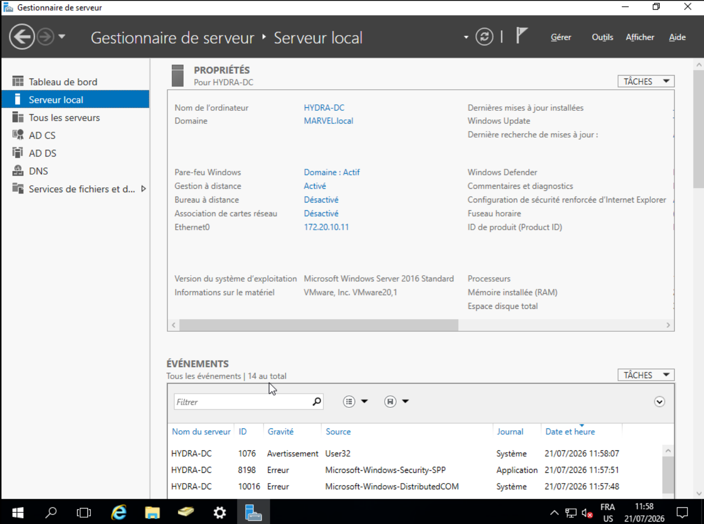

---

## Active Directory Structure

### Organizational Units and Containers

```
MARVEL.local
├── Builtin
├── Computers
├── Domain Controllers
├── ForeignSecurityPrincipals
├── Groups
├── Managed Service Accounts
└── Users
```

### User Accounts Identified

| Username | Type | Notable Attributes |
|----------|------|-------------------|
| Administrator | User | Default domain admin account |
| Frank Castle | User | Standard user |
| Guest | User | Built-in guest account |
| Peter Castle | User | Standard user |
| Peter Parker | User | Standard user |
| SQL Service | User | **Credential exposure: "My pwd is pwd"** |
| Tony Stark | User | Standard user |

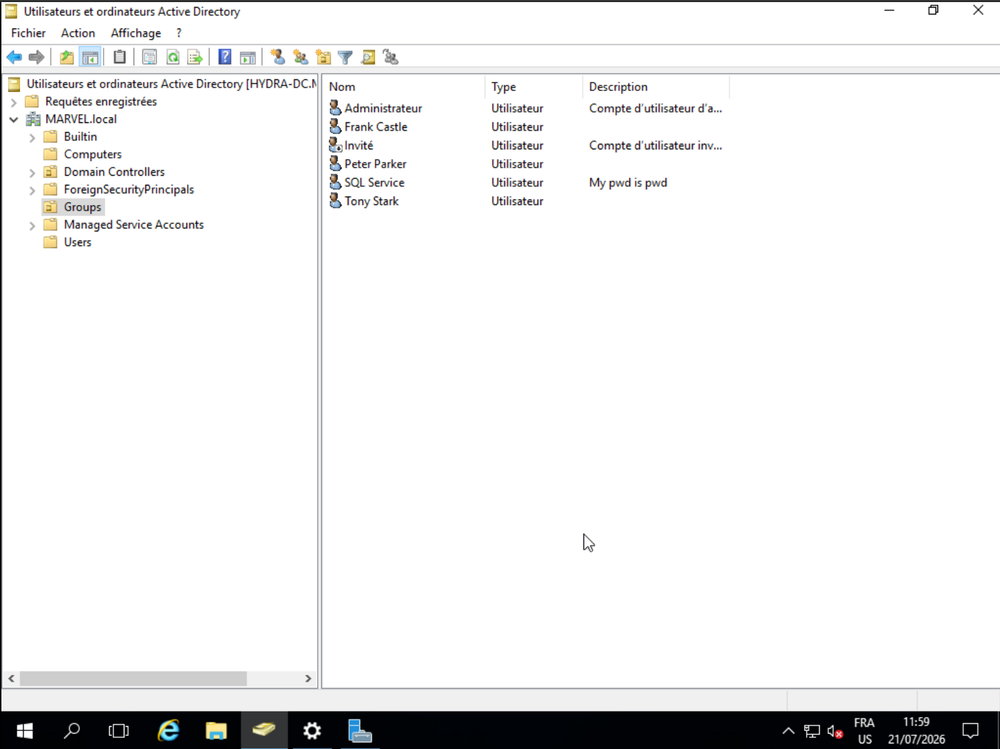

### Computer Objects

| Computer Name | Type |
|--------------|------|
| SPIDERMAN | Workstation |
| THEPUNISHER | Workstation |

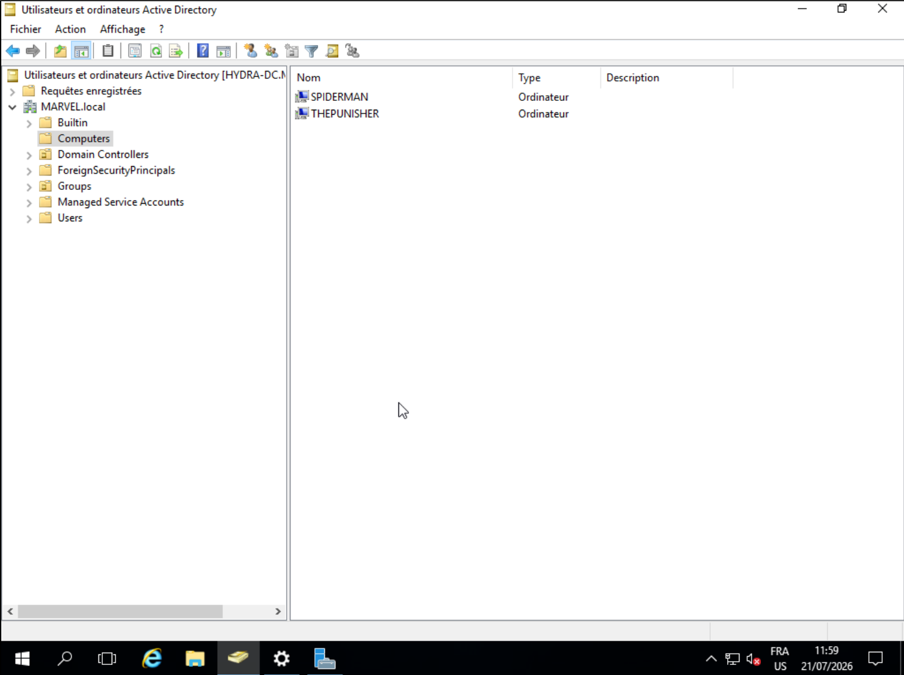

---

## Security Vulnerabilities Identified

### 1. Credential Exposure in Active Directory

The account **SQL Service** has its password (or part of it) exposed directly in the Description field: "My pwd is pwd". This represents a critical security misconfiguration that could lead to account compromise.

### 2. Weak Default Domain Password Policy

The **Default Domain Policy** reveals concerning password policy weaknesses:

| Policy Setting | Value |
|---------------|-------|
| Enforce password history | 24 passwords remembered |
| Maximum password age | 42 days |
| Minimum password age | 1 day |
| Minimum password length | 7 characters |
| Password complexity requirements | Enabled |

**Critical Finding**: Password complexity requirements were initially toggled during the lab, suggesting that security configurations are being actively modified, which may indicate an inconsistent security posture.

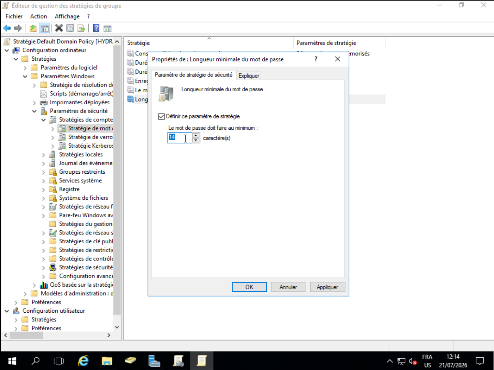
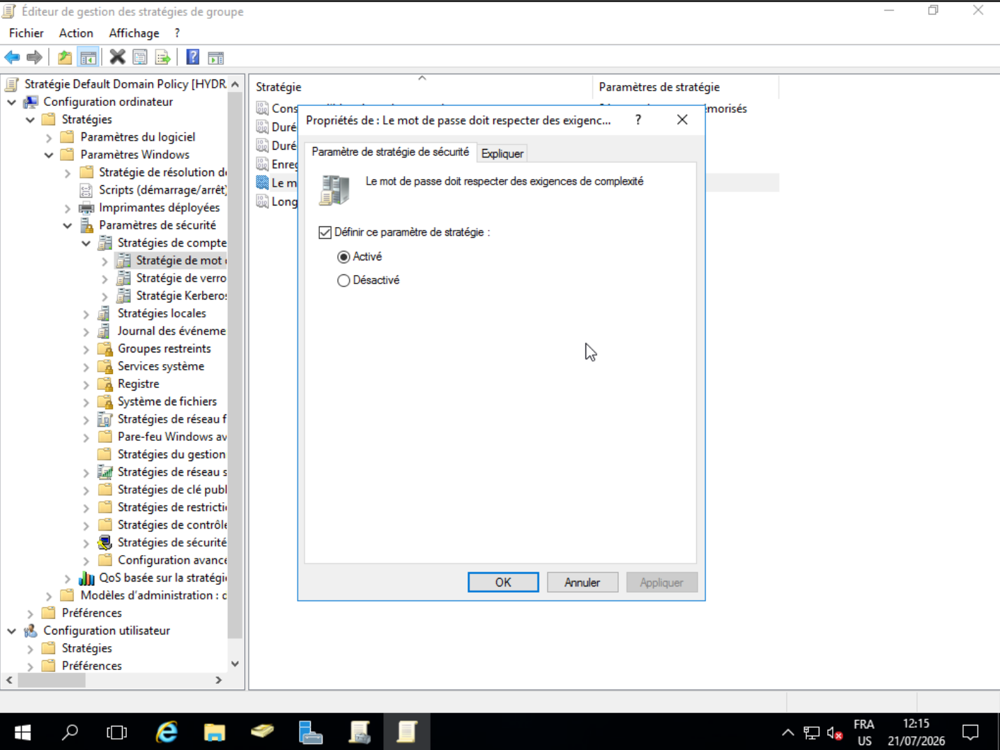


### 3. Software Deployment Vulnerabilities

A Group Policy Object (GPO) named **Software_Deployment_to_All_users** deploys 7-Zip (version 17.01 x64 edition) from:

```
\\HYDRA-DC\Software\7z1701-x64.msi
```

The software deployment source is accessible via network share `\\HYDRA-DC\Software`, which may be writable by domain users, potentially allowing for:
- Package replacement with malicious MSI files
- Binary substitution attacks
- Privilege escalation through application deployment

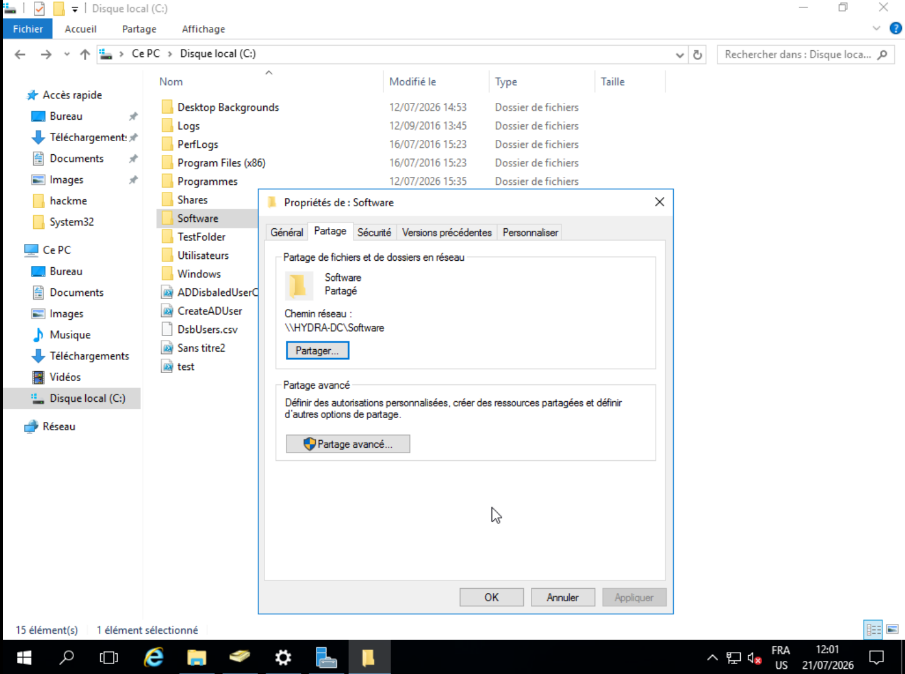

### 4. Network Share Exposure

The **Software** share at `\\HYDRA-DC\Software` is configured with:

| Property | Value |
|----------|-------|
| Share Name | Software |
| Network Path | \\HYDRA-DC\Software |
| Status | Shared |

**Risk**: If this share has overly permissive write access, it could be leveraged for lateral movement or privilege escalation via GPO software installation.

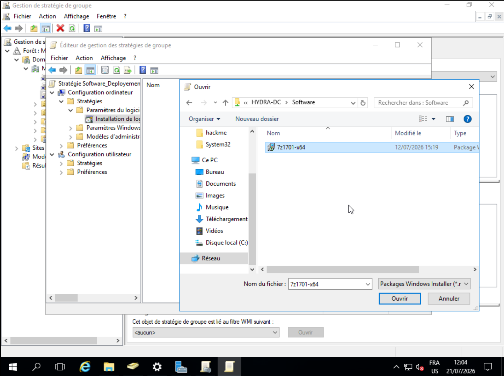
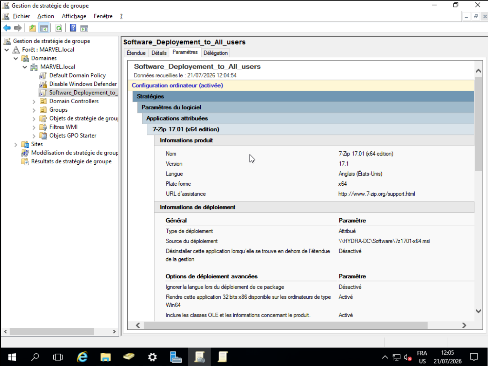
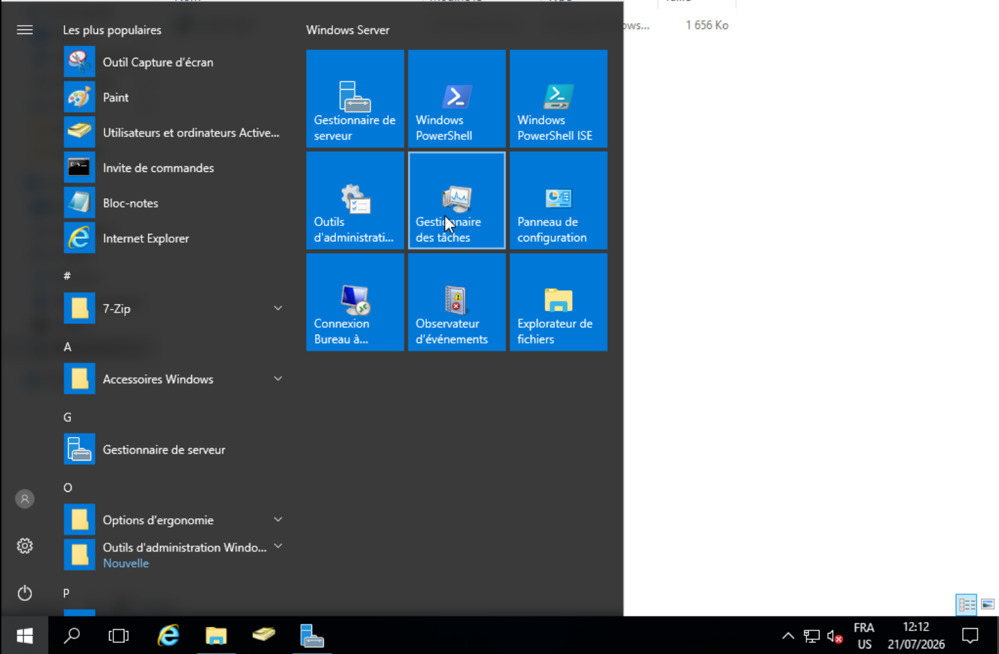

---

## User Creation and Management Script

The lab includes a PowerShell script demonstrating user provisioning with insecure practices:

```powershell
$firstname = Read-Host -Prompt "Enter the first Name"
$lastname = Read-Host -Prompt "Enter the last Name"

New-ADUser `
    -Name "$firstname $lastname" `
    -GivenName "$firstname" `
    -Surname "$firstname" `  # BUG: Should be $lastname
    -UserPrincipalName "$firstname.$lastname" `
    -AccountPassword (ConvertTo-SecureString "P@$$w0rd1234567") `
    -Path "OU=Groups,DC=marvel,DC=local" `
    -ChangePasswordAtLogon 1 `
    -Enabled 1
```

### Script Vulnerabilities:
1. **Hard-coded password**: All new users receive the same initial password
2. **Incorrect attribute mapping**: Surname is incorrectly set to first name
3. **OU Path**: Users are created in the `Groups` OU rather than `Users` OU
4. **Password complexity bypass**: The initial password "P@$$w0rd1234567" must be changed at next logon, but the password is static

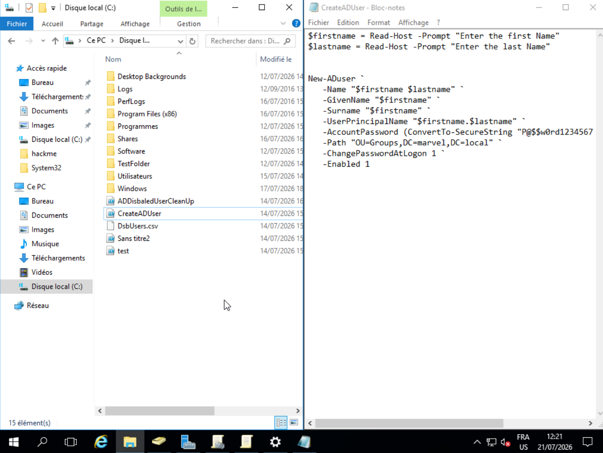
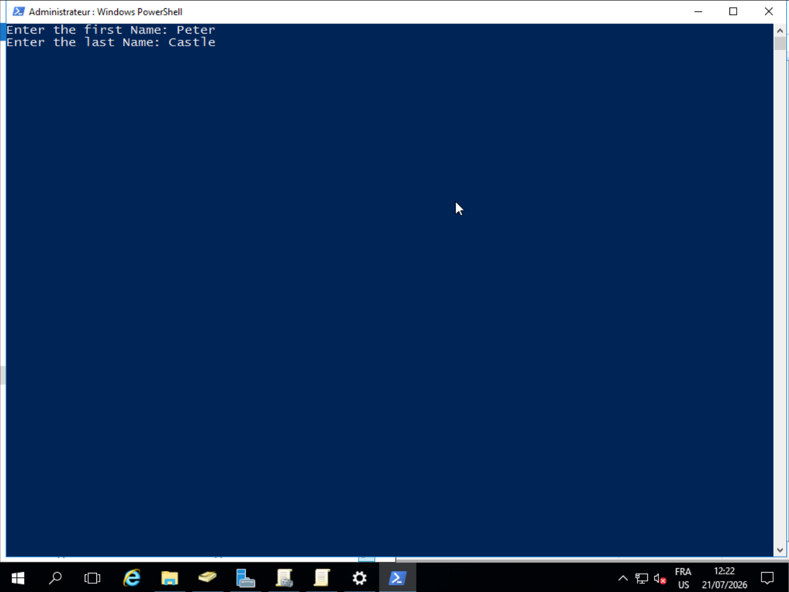
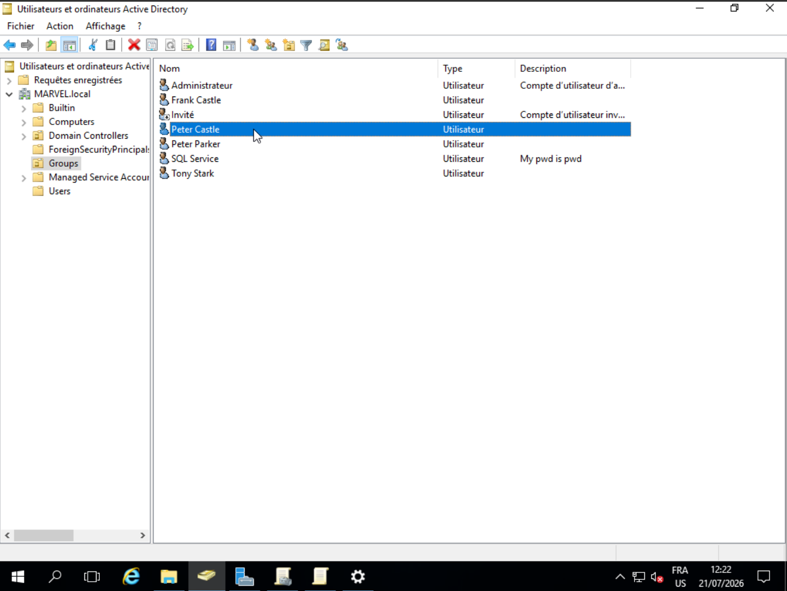
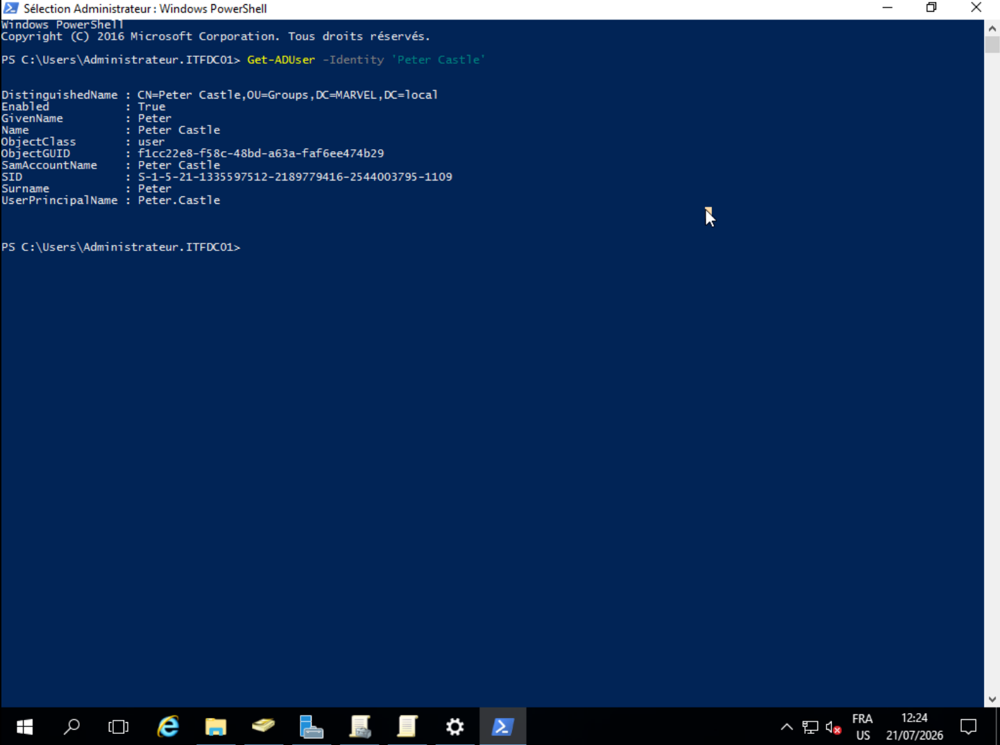

---

## Administrative Access

The domain controller was accessed using the **Administrator** account with password **P@$$wOrd123456**, indicating:

1. The default administrator password does not meet the domain's own complexity requirements (no uppercase letter present)
2. Password reuse across administrative accounts is possible
3. The password is relatively weak and potentially guessable

---

## Authentication Mechanisms

The Windows login screen shows support for:
- Domain authentication (MARVEL\Administrator)
- Local authentication options
- Multi-user login capability

---


## Technical Analysis Summary

This lab effectively demonstrates common Active Directory security misconfigurations found in real-world environments. The weaknesses identified provide a comprehensive testing ground for understanding:

1. **Active Directory Attack Surface**: User enumeration, credential exposure, and privilege escalation paths
2. **Group Policy Security**: Software deployment, password policies, and configuration management
3. **Windows Permissions Models**: Share permissions, NTFS permissions, and delegation
4. **Authentication Security**: Domain authentication, credential management, and access control

---


